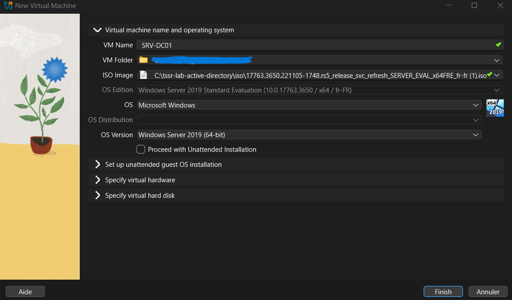
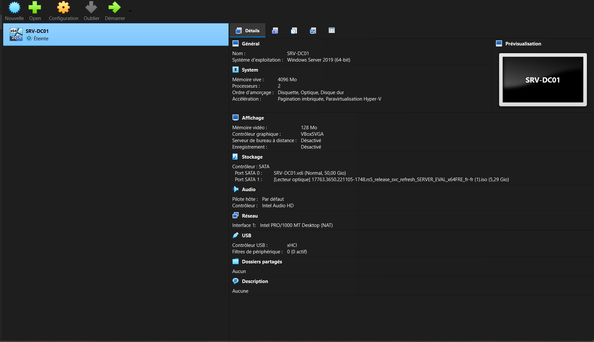

# Étape 2 : création de la VM du serveur

## Objectif

Créer la machine virtuelle `SRV-DC01`, qui deviendra le contrôleur de domaine du laboratoire. Cette étape prépare le matériel virtuel ; Windows Server n'est pas encore installé.

## Caractéristiques de la VM

| Élément | Valeur | Pourquoi |
|---|---|---|
| Nom de la VM | SRV-DC01 | Convention : serveur, contrôleur de domaine, numéro 01 |
| Système | Windows Server 2019 Standard Evaluation (fr-FR) | Version d'évaluation gratuite |
| RAM | 4096 Mo | Suffisant pour AD DS en laboratoire |
| Processeurs | 1 | Évite les lenteurs pendant l'installation |
| Disque | 50 Go (allocation dynamique) | Ne prend que l'espace réellement utilisé |
| Réseau | NAT (provisoire) | Sera remplacé par un réseau isolé à l'étape 3 |

Le nom de la VM dans VirtualBox est distinct du futur nom d'ordinateur Windows, qui sera configuré plus tard.

## Captures d'écran

Fenêtre de création de la VM :

Configuration de la VM créée :

## Difficultés rencontrées

- La case « Proceed with Unattended Installation » a un libellé différent selon les versions de VirtualBox. Dans la version 7.2.20, elle est laissée décochée pour installer Windows manuellement.
- Les sections « Specify virtual hardware » et « Specify virtual hard disk » sont repliées par défaut. Le disque a donc gardé la taille proposée (50 Go) au lieu des 60 Go initialement prévus, ce qui reste suffisant pour le laboratoire.
